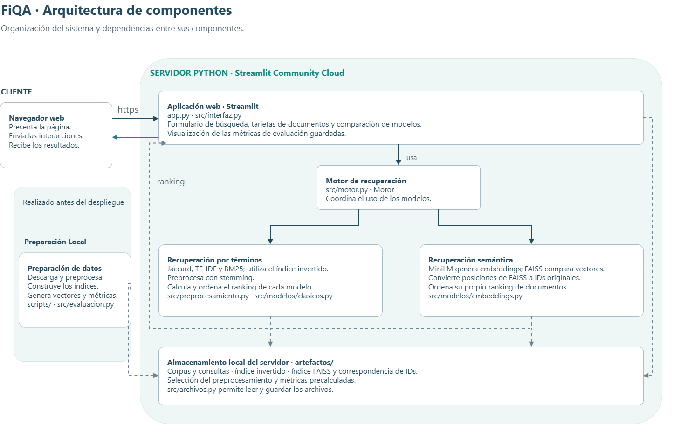

# FiQA Sistema de Recuperación de Información

Explora una colección de **57.638 documentos financieros** y compara cómo responden cuatro modelos de búsqueda a una misma pregunta. FiQA reúne recuperación por términos y búsqueda semántica en una interfaz web con resultados ordenados, textos completos y métricas de evaluación.

**[Abrir la aplicación](https://proyecto-primer-bimestre-ri-jywrddu9m56mmfodc4qjea.streamlit.app/)** · [Código fuente](https://github.com/ambrosiafr/Proyecto-Primer-Bimestre-RI)

## Encuentra y compara

- Escribe una pregunta en inglés y elige el modelo de recuperación.
- Selecciona cuántos resultados quieres consultar.
- Revisa el encabezado, ID, puntaje y texto completo de cada documento.
- Compara los rankings de los cuatro modelos para la misma consulta.
- Explora las métricas por consulta, la comparación por tipo de pregunta y los casos donde cambia el resultado.
- Descarga las métricas de evaluación en CSV.

Una consulta como `How do index funds work?` permite explorar las diferencias entre las coincidencias de palabras y la similitud de significado.

## Cuatro formas de buscar

| Modelo | Criterio de recuperación |
|---|---|
| Binario · Jaccard | Coincidencia entre conjuntos de términos. |
| Vectorial · TF-IDF | Similitud coseno con términos ponderados por frecuencia e importancia. |
| Probabilístico · BM25 | Frecuencia y rareza de los términos, ajustadas por la longitud del documento. |
| Semántico · Embeddings | Vectores de MiniLM y búsqueda de similitud mediante FAISS. |

Cada modelo produce su propio ranking. Los puntajes usan escalas distintas; la tabla permite comparar las posiciones y los documentos recuperados.

## Arquitectura

Streamlit integra la interfaz y el motor de recuperación en un servidor Python. Los módulos de búsqueda por términos y búsqueda semántica calculan y ordenan sus propios resultados. La aplicación recupera los textos mediante sus IDs y presenta las tarjetas y tablas de comparación.

Los índices y las métricas se preparan previamente y se reutilizan durante las búsquedas. MiniLM y FAISS se cargan cuando se necesitan y permanecen disponibles para las consultas posteriores.



## Evaluación de recuperación

Los cuatro modelos se evaluaron sobre el corpus completo con **648 consultas de prueba y 1.706 juicios de relevancia** de FiQA.

| Modelo | Precision@10 media | Recall@10 medio | MAP |
|---|---:|---:|---:|
| Jaccard | 0.0159 | 0.0649 | 0.0339 |
| TF-IDF | 0.0511 | 0.2187 | 0.1354 |
| BM25 | 0.0677 | 0.3071 | 0.2026 |
| Embeddings | 0.1045 | 0.4413 | 0.3117 |

Precision@10 y Recall@10 se promedian entre las consultas de prueba. MAP es el promedio de AP sobre los rankings completos. Estos resultados corresponden al conjunto test de FiQA; la aplicación permite consultar también el detalle de cada pregunta.

## Ejecución local

Se requiere **Python 3.11** y espacio para las dependencias, el corpus y los índices. El procesamiento utiliza CPU.

### 1. Instalar

Desde la carpeta del repositorio, en PowerShell:

```powershell
py -3.11 -m venv .venv
.\.venv\Scripts\python.exe -m pip install -r requirements.txt
```

El modelo de inglés de spaCy se instala con las dependencias. En Linux, utiliza `python3.11 -m venv .venv` y `.venv/bin/python` en los comandos siguientes.

### 2. Obtener los datos preparados

Descarga `fiqa-artefactos.zip` desde las [Releases del repositorio](https://github.com/ambrosiafr/Proyecto-Primer-Bimestre-RI/releases) y extrae su contenido en `artefactos/`. El archivo del corpus debe quedar en `artefactos/corpus.json.gz`, sin carpetas intermedias.

También se puede generar todo desde las fuentes originales:

```powershell
.\.venv\Scripts\python.exe -m scripts.preparar_todo
```

La preparación descarga FiQA, construye los índices, compara stemming y lematización con dev, genera los embeddings y evalúa test. Se realiza una vez; su duración depende del equipo. Al repetirla, se deben completar todas las etapas para mantener juntos los datos y sus índices.

### 3. Iniciar

```powershell
.\.venv\Scripts\python.exe -m streamlit run app.py
```

Abre `http://localhost:8501`. Mantén la terminal abierta mientras utilizas la aplicación; `Ctrl+C` detiene el servidor. La primera búsqueda puede tardar más por la carga inicial de los modelos.

## Datos y tecnología

Los modelos clásicos utilizan fórmulas propias, un índice invertido y stemming, elegido mediante validación con BM25. La búsqueda semántica utiliza `all-MiniLM-L6-v2`, vectores de 384 dimensiones y FAISS `IndexFlatIP` con vectores normalizados. El modelo procesa hasta 256 tokens por texto.

FiQA contiene textos en inglés; sus títulos originales están vacíos, por lo que los encabezados se extraen del contenido. Los documentos sin juicio se consideran no relevantes al evaluar. Se conservan los registros vacíos del corpus, pero se excluyen de los resultados interactivos.

Los archivos preparados y el entorno virtual quedan fuera del historial de Git. En Streamlit Cloud, la aplicación puede descargar el ZIP mediante el secreto `ARTIFACTS_URL`; las consultas se procesan en el servidor.

## Autores y fuentes

**Sebastián Chicaiza y Juan Murillo** · Recuperación de Información.

- [Corpus FiQA](https://huggingface.co/datasets/BeIR/fiqa) y [qrels](https://huggingface.co/datasets/BeIR/fiqa-qrels): CC-BY-SA-4.0.
- [all-MiniLM-L6-v2](https://huggingface.co/sentence-transformers/all-MiniLM-L6-v2): Apache-2.0.
